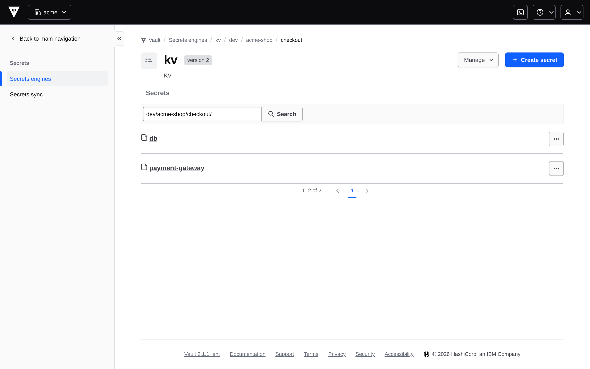
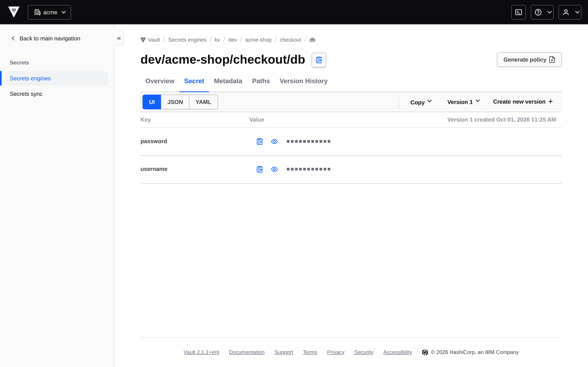
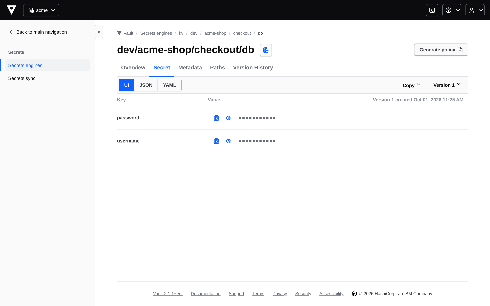
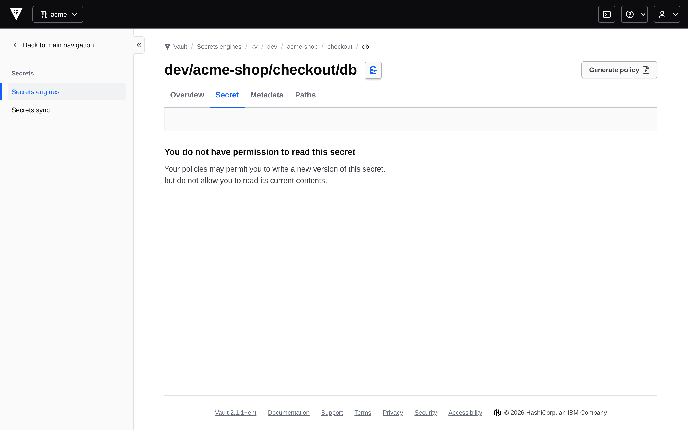

# mto-extension-vault-enterprise charts

Two Helm charts that give every Stakater Multi-Tenant Operator (MTO) `Tenant`
its own Vault Enterprise namespace, configured through
[vault-config-operator](https://github.com/redhat-cop/vault-config-operator)
(VCO) custom resources.

| Chart | Installed | Role |
|---|---|---|
| [mto-extension-vault-enterprise-bootstrap](mto-extension-vault-enterprise-bootstrap/) | once per cluster, by hand | Watches `Tenant` CRs and fans out one render per tenant. Renders the shared Vault namespace. Creates the ServiceAccount VCO logs in with. |
| [mto-extension-vault-enterprise](mto-extension-vault-enterprise/) | never by hand | Per-tenant template. template-operator-v2 (t-op-v2) pulls it and renders it once per `Tenant`. |

The charts only *describe* configuration: they emit VCO CRs, and VCO writes them
to Vault. Transit, PKI and cert-manager integration are **not** supported yet.

## Prerequisites

- **Vault Enterprise** (tested on 2.1.1). Tenant isolation is one Vault namespace per tenant, and
  namespaces exist only in Enterprise. On Community Edition, Vault ignores the
  namespace: every tenant's objects land in root and collide, and most of them
  still report success.
- **vault-config-operator v1.0.3 or later.** It is the first release with the two
  changes the charts need (upstream PR
  [#373](https://github.com/redhat-cop/vault-config-operator/pull/373)):
  1. `spec.authentication.targetNamespace` (upstream issue
     [#291](https://github.com/redhat-cop/vault-config-operator/issues/291)).
     VCO logs in once, in `vco.namespace`, and writes each tenant's objects into
     `<vco.namespace>/<tenant>`. Without the field the apiserver prunes it and
     every object lands in the login namespace.
  2. The `Namespace` kind fix, two parts. In every release since v0.8.50 the
     Namespace controller panics on each reconcile (`interface conversion:
     interface {} is nil, not *api.Client`, `namespace_controller.go:77`), so no
     Vault namespace is ever created. And once one exists, every later reconcile
     fails with `namespace "<x>/" already exists`, which delays a tenant's
     deletion by up to ~16 minutes of back-off.
- template-operator-v2 ≥ 0.0.5 (child TemplateInstances need
  `namespaceSelector`).
- MTO's `Tenant` CRD. MTO labels each tenant namespace with
  `stakater.com/tenant: <tenant>`; that label is what the charts key on.
- External Secrets Operator, only if `parent.eso=enabled` (the default).

## How it fits together

```
Tenant CRs ──► parent TemplateInstance (mto-extension-vault-enterprise-parent)
                 once per cluster     the shared Vault namespace, its kv and auth mount
                 per Tenant           Namespace <tenant>, SecretEngineMount <tenant>-kv
                 per Tenant with a    TemplateInstance mto-extension-vault-enterprise-<tenant>      → core slice
                 labelled namespace   TemplateInstance mto-extension-vault-enterprise-<tenant>.eso  → eso slice

core slice (in configNamespace)        VCO writes to Vault
  AuthEngineMount    <tenant>-kubernetes   kubernetes/workloads/           (in <tenant>)
  KubernetesAuthEngineConfig …         kubernetes/workloads/config
  Policy + KubernetesAuthEngineRole    one pair per annotated ServiceAccount
  AuthEngineMount + JWTOIDC* + Policy  SSO, when sso.enabled
core slice (in workload namespaces)
  ConfigMap vault-config-<sa>          VAULT_* environment for the workload
  ConfigMap vault-apps                 per-namespace index of apps and paths
eso slice (in workload namespaces)
  SecretStore <sa>-vault, ExternalSecret <sa>-<name>
```

**A tenant's Vault namespace and kv mount live as long as its `Tenant` CR**,
not as long as its namespaces. The parent renders them for every Tenant. The
workload render (auth mount, roles, policies, ConfigMaps, ExternalSecrets)
exists only while the tenant has at least one labelled namespace: its child
TemplateInstance would otherwise fail parameter validation. So deleting a
tenant's last namespace removes its grants and keeps its secrets; labelling a
namespace again brings the grants back.

The parent **skips** a Tenant whose name is not a DNS label (the Tenant CRD does
not restrict names; a dot or an uppercase letter would break the Vault
namespace, the label value and the object names), a Tenant whose name is longer
than 63 characters (it is a label value, and label values cap at 63), and a
Tenant named like the shared namespace (`parent.sharedTenantName`, default
`shared`). Each skip is
listed, with the reason, in the ConfigMap
`mto-extension-vault-enterprise-skipped-tenants` in `configNamespace`.

## Vault bootstrap (one time, by a Vault admin)

VCO logs in to Vault with the Kubernetes auth method **once, in
`vco.namespace`** (empty = root), as the ServiceAccount the bootstrap chart
creates. Before the bootstrap chart can do anything, a Vault admin sets up that
login:

```bash
vault auth enable kubernetes
vault write auth/kubernetes/config kubernetes_host=https://kubernetes.default.svc:443
vault policy write vco-admin examples/vco-admin-policy.hcl
vault write auth/kubernetes/role/vco-admin \
  bound_service_account_names=vco-admin \
  bound_service_account_namespaces=vault-config \
  token_policies=vco-admin token_ttl=1h
```

`kubernetes_host` without `token_reviewer_jwt`: Vault then reviews tokens with
its own ServiceAccount, which must be bound to `system:auth-delegator` (the
HashiCorp Helm chart does this by default). No reviewer credential is stored.

The policy lives in the login namespace and grants paths inside child namespaces
by prefixing them with the namespace: `+/sys/policy/*` matches the `sys/policy/`
path of every direct child. The `+` on the namespace segment is not shown in the
Vault documentation; it follows from `vault/policy.go`, which matches a policy
path against the full request path including the namespace. The lab
([hack/lab/vco-admin-policy.hcl](../hack/lab/vco-admin-policy.hcl)) is where this
is tested.

[examples/vco-admin-policy.hcl](examples/vco-admin-policy.hcl) is the production
policy: it **denies delete** on the data-bearing paths — see
[Deletion](#deletion). The lab uses a broader one that allows deletes, so its
e2e teardown can finish.

## Install

```bash
helm upgrade --install mto-extension-vault-enterprise-bootstrap \
  oci://ghcr.io/stakater/charts/mto-extension-vault-enterprise-bootstrap \
  -n vault-config --create-namespace \
  --set parent.vaultServer=https://vault.example.com:8200
```

Values that matter (bootstrap chart):

| Value | Default | Meaning |
|---|---|---|
| `configNamespace` | `vault-config` | Holds every Template, TemplateInstance and VCO CR. Install the chart into it. |
| `vco.authPath` / `vco.role` / `vco.serviceAccount` | `kubernetes` / `vco-admin` / `vco-admin` | How VCO logs in. Must match the Vault bootstrap. |
| `vco.namespace` | `""` (root) | The Vault namespace VCO logs in to, and the parent of every tenant namespace. |
| `kubernetesAuth.path` / `.name` | `kubernetes` / `workloads` | The workload auth mount inside each tenant namespace: `kubernetes/workloads`. |
| `kubernetesAuth.tokenReviewerServiceAccount` | `""` | Set only when Vault runs outside the cluster. |
| `templateOperator.serviceAccountName` / `.namespace` | `template-operator-template-operator-v2` / `stakater-template-operator` | t-op-v2's identity, which the RBAC binds to. |
| `tenantChart.registry` / `.version` | `oci://ghcr.io/stakater/charts` / chart version | Where t-op-v2 pulls the tenant chart. |
| `parent.eso` | `enabled` | `"enabled"` or `"disabled"` — a string, not a boolean. |
| `parent.token` | `{}` | Workload token `type`, `ttl`, `maxTTL`. **Integer seconds.** |
| `parent.sso.*` | off | Human SSO (see below). `enabled=true` requires `issuerUrl`; the install fails without it. |
| `tenantValues` | `{}` | Any other tenant chart value, install-wide: `vaultCABundle`, `monitoring`, `sso.oidc.*`, `sso.tiers`, `tierCaps`, `ssoToken`, … A key this chart already sets fails the render and names the value to use. |

t-op-v2 pulls the **published** tenant chart, so `tenantValues` is the only way
to set a tenant chart value on a cluster; editing the tenant chart's own
`values.yaml` has no effect there. A Vault served with a private CA needs
`tenantValues.vaultCABundle`: it becomes each SecretStore's `caBundle` and a
`vault-ca-bundle` ConfigMap in every workload namespace.
| `sync.mode` | `revert` | t-op-v2 drift protection for everything rendered. |

Toggles are validated twice — by `values.schema.json` and by template guards
that survive `--skip-schema-validation` — because a near-miss (`yes`, `on`,
`True`) would otherwise disable a feature silently.

## Trust boundary

**The `stakater.com/tenant` label on a namespace is what grants a tenant's
Vault access.** The parent finds a tenant's namespaces by that label, and the
tenant chart renders a Policy and Role for every annotated ServiceAccount in
them. So anyone who can set `stakater.com/tenant: X` on a namespace can give
their own ServiceAccounts tenant X's Vault access.

Keep that label under the platform's control: only MTO (and cluster admins)
may set or change it. Tenant users must not be able to label or relabel
namespaces — in particular they must not hold `patch` or `update` on
`namespaces` at cluster scope. MTO's own namespace handling is built on the same
label, so this is the same rule MTO already needs.

Inside a tenant, the ServiceAccount annotations decide which app gets which
access. Anyone who can annotate a ServiceAccount in a tenant namespace can
request that tenant's access for it, up to the `admin` tier.

## Workload access

Access is opt-in per ServiceAccount, with annotations:

| Annotation | Value | Effect |
|---|---|---|
| `vault.stakater.com/kv` | `"true"` | The app's own KV prefix. |
| `vault.stakater.com/tier` | `viewer` \| `editor` \| `admin` \| `audit-read` | Required with `kv`. How much access. |
| `vault.stakater.com/app` | name | The app that owns the prefix. Default: the ServiceAccount name. |
| `vault.stakater.com/kv-subscribe-ns` | CSV of namespaces | Read-only access to those sibling namespaces' `_shared/` prefix. |
| `vault.stakater.com/kv-export-tenant` | CSV of tenants | Write access to `from-<own>/to-<peer>/` in the shared namespace. |
| `vault.stakater.com/kv-import-tenant` | CSV of tenants | Read access to `from-<peer>/to-<own>/` in the shared namespace. |

The KV layout inside the tenant's `kv/` mount:

```
kv/data/<env>/<namespace>/<app>/...           the app's own secrets
kv/data/<env>/_shared/from-<namespace>/...    written by that namespace's editor/admin apps,
                                              read by every app there and by subscribers
```

For each annotated ServiceAccount the chart renders a `Policy` and a
`KubernetesAuthEngineRole` named `kv.<tenant>.<namespace>.<sa>`, and a ConfigMap
`vault-config-<sa>` in the workload namespace:

```
VAULT_ADDR, VAULT_CACERT (with vaultCABundle), VAULT_NAMESPACE=<vco.namespace>/<tenant>,
VAULT_K8S_MOUNT=kubernetes/workloads, VAULT_K8S_ROLE, VAULT_KV_APP_PATH, VAULT_KV_SHARED_OUT_PATH,
VAULT_FROM_<NS>_PATH, VAULT_OUT_<PEER>_*, VAULT_IN_<PEER>_*
```

A misconfigured ServiceAccount gets a ConfigMap `vault-config-<sa>.error` that
says what is wrong, and nothing else. Reported per ServiceAccount rather than
failing the render, so one namespace's mistake does not stop the tenant's other
namespaces. An unknown `vault.stakater.com/` key is an error, not ignored; so
are `transit` and `pki`, which this extension does not support.

### ExternalSecrets

With ESO enabled, annotate the Deployment:

| Annotation | Value | Reads |
|---|---|---|
| `vault.stakater.com/kv-secret.<name>` | `<leaf>[#<key>]` | the app's own `<leaf>` |
| `vault.stakater.com/kv-subscribe.<name>` | `<writer-ns>/<leaf>[#<key>]` | a subscribed `_shared/` leaf |
| `vault.stakater.com/kv-import.<name>` | `<peer>/<leaf>[#<key>]` | an imported share leaf |

Each renders ExternalSecret and Secret `<sa>-<name>`. The Deployment's
`serviceAccountName` must be an annotated ServiceAccount that grants the path;
otherwise a `vault-config-<deployment>.deploy-error` ConfigMap explains why.

## Human SSO

`parent.sso.enabled=true` with `parent.sso.issuerUrl` gives each tenant an OIDC
mount `oidc/sso` and one role per tier, bound to the IdP group
`<tenant>-<tier>s` (`sso.tenantGroupTemplate`). The client secret is a Secret
`vault-oidc-client-secret` (key `client-secret`) in `configNamespace`.

All tenants share one IdP client, `tenantValues.sso.oidc.clientId` (default
`vault`). Set it to the ID of Vault's client in the IdP (with Dex: the DCO
`Client`'s `id`). It is also the audience every SSO role accepts, because an ID
token's `aud` is the client ID it was issued to, so there is no separate
audience value. `parent.sso.issuerUrl` is the issuer Vault talks to — Dex's,
when Keycloak sits behind Dex. Log in with:

```bash
VAULT_NAMESPACE=<tenant> vault login -method=oidc -path=oidc/sso role=sso.<tenant>.editor
```

### What each tier sees in the Vault UI

Tenant `acme`, app `checkout` in namespace `acme-shop`. Each user's Keycloak
group gives the tier.

The app's secrets, under its own prefix `dev/acme-shop/checkout/`:



**Editor** (`acme-editors`): reads the keys, with the values masked, and can
write a new version.



**Viewer** (`acme-viewers`): reads the same keys, and cannot write.



**Audit-read** (`acme-audit-reads`): lists the same secret names as in the
first image, and cannot read a value.



The e2e suite takes these images and checks each view
([docs/screenshots/](../docs/screenshots/)).

## Monitoring

`tenantValues.monitoring.enabled=true` gives each tenant a PrometheusRule with
one alert, `VaultExternalSecretSyncFailed`: an ExternalSecret in one of the
tenant's namespaces has `Ready=False` for 5 minutes. ESO's metric
(`externalsecret_status_condition{name, namespace, condition, status}`) has no
tenant label, so the rule lists the tenant's namespaces. It needs ESO's metrics
scraped. There is no alert on the VCO objects — see Health.

## Health

t-op-v2 reports that a render was **applied**, not that VCO could write it to
Vault. The child TemplateInstance's `status.outputs` carries two fields per VCO
kind, keyed by object name:

| Field | Meaning |
|---|---|
| `<kind>Succeeded` | `["True"]` once VCO has written the object at least once. `[]` means never — the one unambiguous failure. |
| `<kind>LastError` | The message of the most recent failed reconcile, **ever**. It stays after the object recovers. |

VCO's status cannot say whether an object is healthy *now*. It sets
`ReconcileSuccessful` (always `True`) and `ReconcileFailed` (always `False`)
side by side, and both `lastTransitionTime` values freeze after their first
write. The ExternalSecret outputs of the `.eso` TemplateInstance are the signal
that tracks the data path now.

## Deletion

VCO has no deletion policy. When a CR is deleted, VCO deletes the object in
Vault. For the `Namespace` CR that deletes the tenant's Vault namespace and
every secret in it, and Vault cannot restore a deleted namespace (snapshots do
not restore a namespace either).

The protection is the VCO login's Vault policy: **do not grant `delete` on
`sys/namespaces/*` or on the tenants' `sys/mounts/*`**. VCO's delete call then
fails, the data stays, and the CR stays in `Terminating` with VCO's finalizer
until a person decides. To really delete a tenant, a Vault admin deletes the
namespace, then removes the finalizer from the CR.

Renaming a mount or a tenant is a delete plus a create, so the same applies.

Names are joined with dots (`kv.<tenant>.<namespace>.<sa>`,
`share.<tenant>.<namespace>.<sa>.out.<peer>`, `sso.<tenant>.<tier>`). None of
the parts can contain a dot, so two different sets of parts can never give the
same name — with hyphens, namespace `t-web` + ServiceAccount `api-x` and
namespace `t-web-api` + ServiceAccount `x` did. Each family has its own number
of parts (4, 6 and 3), so a name of one family never equals a name of another:
without the `kv.` prefix, tenant `sso` with namespace `acme` and ServiceAccount
`admin` got the name of tenant `acme`'s SSO admin Policy.

What is tested: the e2e suite proves that deleting a tenant's last namespace
keeps its Vault namespace and secrets. It also deletes a Tenant under the
production policy ([examples/vco-admin-policy.hcl](examples/vco-admin-policy.hcl)):
the grants go, the Vault namespace, the kv mount and the tenant's shares in
the shared namespace stay, the two CRs stay `Terminating`, and the admin
procedure above then finishes the deletion.

A cross-tenant share lives in the shared Vault namespace, not in either
tenant's, so deleting a tenant never deletes it. The share roles go with the
tenant, on both sides. A new tenant with the same name gets them back, and with
them the old share data: delete `from-<tenant>/` and `to-<tenant>/` paths in the
shared namespace when a name must not be reused with its data.

## Uninstall

Order matters. Delete the parent TemplateInstance first, wait until every VCO
CR is gone, and only then uninstall the release:

```bash
kubectl -n vault-config delete templateinstance mto-extension-vault-enterprise-parent --wait
kubectl -n vault-config get namespaces.redhatcop.redhat.io,policies.redhatcop.redhat.io   # wait for "No resources"
helm uninstall mto-extension-vault-enterprise-bootstrap -n vault-config
```

A bare `helm uninstall` deletes two things the teardown still needs, in the
same step as the parent TemplateInstance (both measured on the lab):

- **the RBAC.** t-op-v2 then gets `forbidden` removing its finalizers, and every
  TemplateInstance stays in `Terminating`.
- **the VCO login ServiceAccount.** VCO then fails with `serviceaccounts
  "vco-admin" not found` on every delete, and every CR it had written stays in
  `Terminating` on VCO's finalizer.

Recovering needs the RBAC and the ServiceAccount put back by hand until the
teardown finishes. With the Vault policy that denies deletes (see
[Deletion](#deletion)), the data-bearing CRs stay `Terminating` in either order
— that is the intended protection, not this failure.

## Not supported yet

- Transit and PKI engines, cert-manager `Issuer`s, trust-manager `Bundle`s.
- Drift correction is VCO's: off by default, and every 10 hours when
  `ENABLE_DRIFT_DETECTION=true` unless `SYNC_PERIOD_SECONDS` is lowered.
